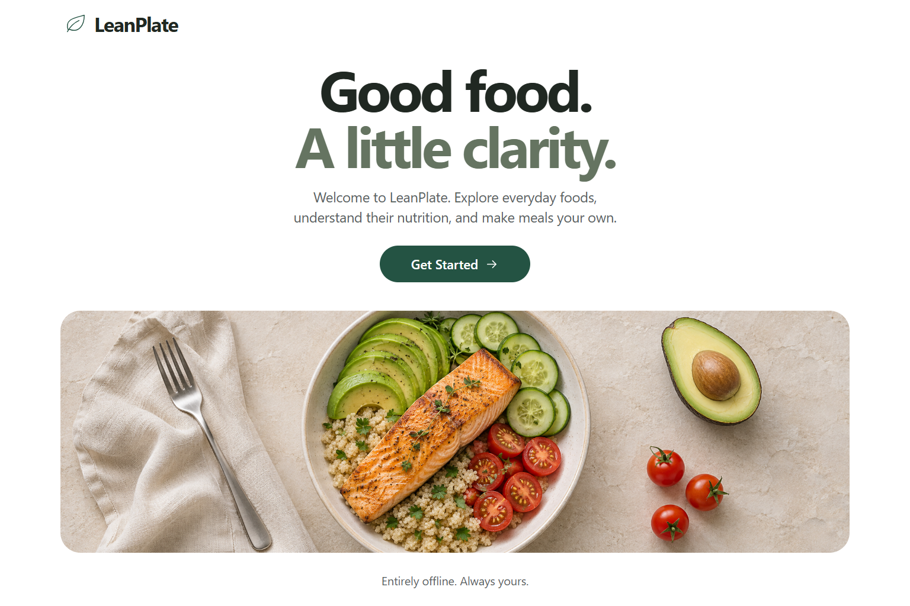
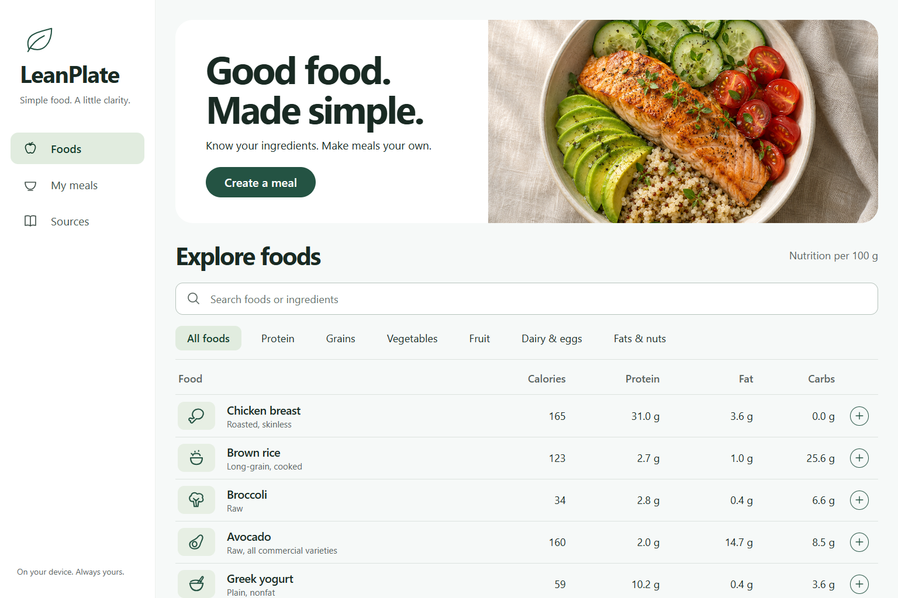
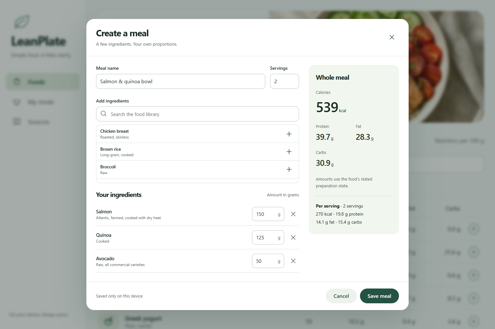
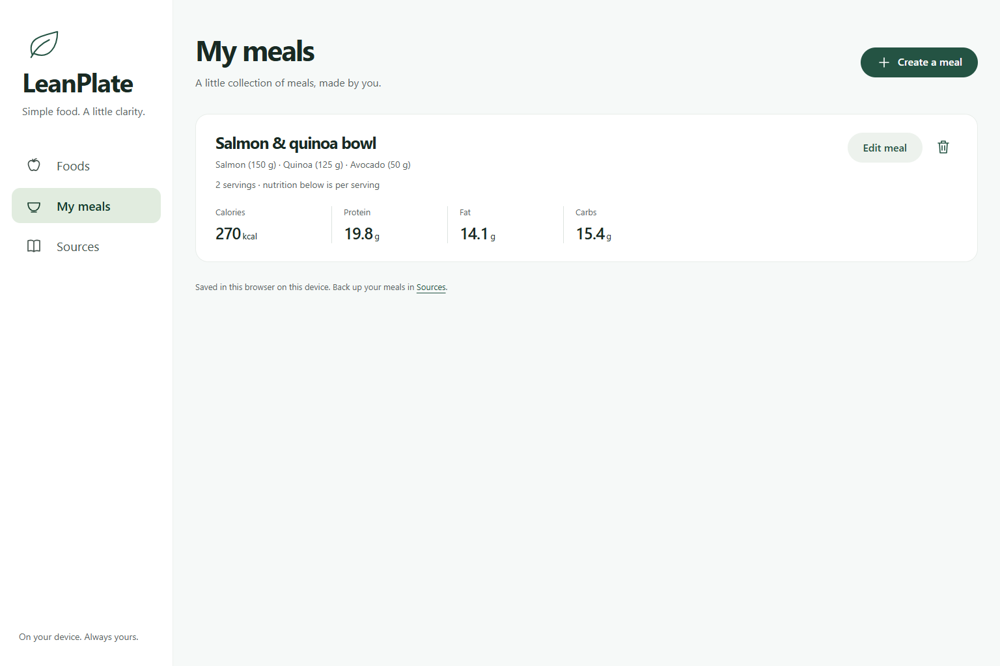
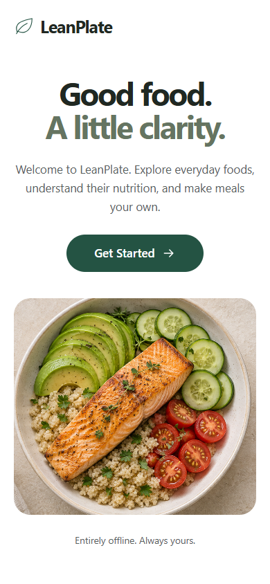

# LeanPlate

**Good food. A little clarity.**

A small, offline nutrition and meal planning app. Search 30 common foods, inspect calories and macros, and save meals made from your own ingredient amounts.

## Open the app

Use a current desktop browser such as Chrome or Edge. JavaScript must be enabled for the main app; the landing page itself needs no JavaScript.

1. If you downloaded the ZIP, right-click it and choose **Extract All**. Keep the extracted folder together.
2. Open **landing.html** in Chrome or Edge. You should see **Good food. A little clarity.**, a large food photograph, and one **Get Started** button. No installation, account, server, or internet connection is needed.
3. Select **Get Started** to open the main app. **Success:** **Good food. Made simple.** and the searchable food table appear, even with Wi-Fi turned off.

You can still open **index.html** directly to skip the welcome page. Its path, code, styles, and local saving behavior are unchanged. The welcome page uses separate HTML and CSS, has no JavaScript or animations, and does not read or write your saved meals.

## Make your first meal

1. Select **Create a meal** and give it a name.
2. Search the food library and use **+** to add ingredients.
3. Enter each ingredient’s edible weight in grams. Match the listed preparation state: cooked rice is weighed after cooking, raw vegetables before cooking.
4. Set the number of servings. Whole-meal and per-serving totals update as you type.
5. Select **Save meal**. **Success:** it appears under **My meals** and remains after you close and reopen the app in the same browser.

To change a meal, select **Edit meal**. To remove one, select its trash button and confirm **Delete meal**. Canceling an edit leaves the saved meal unchanged.

## Keep a backup

Meals are saved in this browser’s local storage, not in the app folder or ZIP. Use the same browser and keep the app at the same path. Clearing browser data, private browsing, moving the folder, or changing browser profiles can make the saved meals unavailable.

1. Open **Sources** and select **Export meals**. Save the JSON file somewhere you can find it.
2. On another browser or after moving the app, open **Sources → Restore a backup** and select that file.
3. Read the replacement confirmation and select **Restore meals**. This replaces the current collection, so export it first if needed. **Success:** the restored meals appear in **My meals**.

If a save fails, the app shows an error and leaves the editor open. It does not report success or overwrite the previous saved meals. If stored data is unreadable, export the original stored text using the recovery button in Sources before restoring a valid backup. Avoid editing the same collection in multiple tabs at once.

## Features

- **Food library:** search 30 common foods and narrow the results by category.
- **Nutrition details:** calories, protein, fat, and carbohydrates per 100 grams or an amount you choose.
- **Meal builder:** create, edit, and delete meals; adjust ingredient weights and serving counts; see live whole-meal and per-serving totals.
- **Local saving:** keep meals in the same browser, with optional JSON export and restore.
- **Traceable sources:** a bundled USDA database with individual source IDs, original descriptions, and clear preparation states.
- **Minimal design:** a separate landing page, responsive layouts, keyboard-accessible controls, and reduced-motion support.

No AI features, accounts, trackers, analytics, remote fonts, APIs, or runtime dependencies. The decorative photograph is bundled locally. External USDA reference links require internet; the same record descriptions, source IDs, and nutrition values remain available offline.

The database is a fixed subset of USDA SR Legacy (April 2018), downloaded November 9, 2026. Values are estimates for generic foods and vary by brand and preparation. See [SOURCES.md](SOURCES.md) for provenance and calculation details.

Ingredient contributions are calculated from the unrounded values per 100 grams. Whole-meal totals are divided by the serving count for per-serving values. Only the displayed values are rounded: whole kcal and one decimal gram. Carbohydrates are total carbohydrates, not net carbohydrates; USDA energy is retained directly rather than recalculated from macros.

## Real screenshots

These images were captured from the working local app in Chrome with network access disabled. They are actual browser screenshots, not design mockups. The example meal was created only in an isolated test browser and is not preloaded into the app. Capture details are in [the screenshot notes](docs/screenshots/README.md).

### Food library

Search ingredients, compare nutrition, and inspect each food's preparation state.

### Meal editor

This example uses 150 g cooked salmon, 125 g cooked quinoa, and 50 g avocado, divided into two servings.

### Saved meals

Saved meals show their ingredients and per-serving nutrition, with controls for editing and deletion.

### Mobile landing page

The welcome page adapts to a narrow screen while keeping Get Started easy to reach.

## For developers

The app uses HTML, CSS, and plain JavaScript with no build step. Open `landing.html` for the welcome page or `index.html` directly for normal offline app use.

- `landing.html` and `landing.css`: isolated, script-free welcome page.
- `assets/landing/food-table.png`: bundled panoramic welcome image, independent of the app's original image.
- `index.html`: app shell and restrictive Content Security Policy.
- `styles.css`: responsive visual system.
- `js/app.js`: food browsing, meal editor, local persistence, backups.
- `js/core.js`: nutrition calculations and data validation.
- `data/foods.js`: bundled browser data; JSON and CSV copies are also included.
- `docs/screenshots/`: actual browser captures referenced by this README.
- `tests/core.test.cjs`: nutrition calculation and data validation tests.
- `tools/build-foods.py`: reproducible extraction from the official USDA ZIP.

With Node.js 20 or later, run `npm test` for calculation and validation tests. **Success:** all five tests pass. No package installation is needed.

For an optional localhost preview, run `npm start`, then open `http://127.0.0.1:4178`. This binds only to this computer. Stop it with Ctrl+C. The preview URL has separate browser storage from direct-file use; transfer meals using Export/Restore when switching modes. This is a direct-file offline app, not an installed PWA; use `index.html` when the preview server is stopped.

For the welcome page in the optional preview, open [http://127.0.0.1:4178/landing.html](http://127.0.0.1:4178/landing.html). The root URL continues to open the main app.

## Troubleshooting

- **Missing styles or images:** extract the whole folder before opening the HTML file, and keep the asset folders beside it.
- **Meals seem to be missing:** check the browser profile and app path. Restore a JSON backup if needed.
- **A save fails:** leave the editor open and check whether local storage is blocked or full. Previous saved meals are left unchanged.

Tested with Chrome on Windows at desktop, tablet, and phone viewport sizes, plus an offline opening and saving check in Edge. Mobile sizes are responsive browser tests, not tests on physical iOS or Android devices. The app requires no hosting service. The decorative food images are generated illustrations, not measured recipes; there are no AI features in the app.

